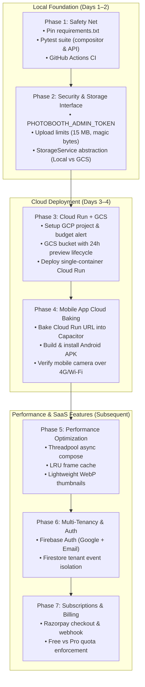

# Photo Booth — Comprehensive Roadmap & Next Steps

This document outlines the current operational status, strategic infrastructure decisions (Cloud Run vs. Local, Free Tier analysis), and a concrete, security-hardened implementation plan to take the Photo Booth from local prototype to commercial SaaS.

---

## 1. Current State & Verification (October 2026)

* **Stack & Health**: Docker Compose stack (`backend` on `:3201`, `web` on `:3200`) is active and passing health checks (`cm test photo-booth` 2/2).
* **Restored Production Data**: 83 MB across 135 files (sessions `PhotoBooth_27092026` and `PhotoBooth_03102026`) safely restored from Mac backup.
* **Core Flow**: Webcam capture $\rightarrow$ frame selection $\rightarrow$ canvas composition $\rightarrow$ preview $\rightarrow$ final download works end-to-end.
* **Critical Findings Before Cloud Deployment**:
  1. **Destructive Endpoints Unprotected**: `POST /admin/cleanup` (which can wipe all finals/previews) and `POST /frames/upload` have no authentication. Deploying to Cloud Run with `--allow-unauthenticated` in this state would expose them to the public internet.
  2. **Upload Constraints**: Lack of file size and magic-byte checks exposes a 512 MiB Cloud Run instance to memory exhaustion (OOM).
  3. **Ephemeral Storage**: Cloud Run instances have ephemeral filesystems. Images written to `/app/data` vanish when instances scale down to 0 unless backed by Google Cloud Storage (GCS).
  4. **LAN Testing Limitation**: `scripts/start-https-proxy.sh` uses macOS-specific `ipconfig getifaddr en0`, which breaks on Windows/WSL2.

---

## 2. Infrastructure Strategy: Cloud Run Timing & Free Tier

### 2.1 Should We Switch to Cloud Run Now or at the End?

**Decision: Fast-track Cloud Run to Phase 3 (Early Deployment), but NEVER before Phase 2 (Security & Storage Abstraction).**

| Strategy | Pros | Cons | Recommendation |
|---|---|---|---|
| **Deploy Immediately (Day 1)** | • Immediate global HTTPS URL<br>• Camera `getUserMedia` works on mobile without self-signed certs<br>• Easy testing from 4G/5G anywhere | • **Data Loss**: Photos vanish when container scales to 0<br>• **Security Vulnerability**: Anyone can trigger `/admin/cleanup`<br>• **Crash Risk**: Large 12 MP photos can OOM a 512 MB instance | ❌ **Dangerous** |
| **Wait Until Very End (After Billing & Auth)** | • Everything built before going live | • Delays real-world mobile testing on physical devices<br>• Painful local Wi-Fi / self-signed certificate workarounds | ❌ **Too Slow** |
| **Phased Early Switch (Phase 3 - Recommended)** | • Lock down security & storage first (2 days)<br>• Deploy Cloud Run + GCS as the permanent mobile backend<br>• Test physical phone apps anywhere with zero cert issues | • Requires 1-2 days of groundwork before cloud deploy | ✅ **Recommended Sweet Spot** |

### 2.2 Google Cloud Free Tier Reality for Initial Productization

Google Cloud's **Always Free Tier** is more than sufficient for development, prototype demos, and early beta testing with zero out-of-pocket costs:

1. **Google Cloud Run**:
   * **Free Tier**: 2,000,000 requests/month, 360,000 GB-seconds of memory, 180,000 vCPU-seconds.
   * **Behavior**: Scales to **0 instances** when idle. If you aren't actively testing, it consumes **0 compute and ₹0**.
   * **Instance Sizing**: 1 vCPU + 1 GiB memory comfortably stays in free tier for thousands of photo sessions.
2. **Google Cloud Storage (GCS)**:
   * **Free Tier**: 5 GB-months of standard storage (US regions) or ~$0.023/GB/mo in Mumbai (`asia-south1` — less than ₹2 per GB).
   * **Lifecycle Rules**: Automatically delete temporary previews after 24 hours to keep usage well under 1 GB.
3. **Firebase Authentication & Firestore**:
   * **Free Tier**: Unlimited email/password, 50,000 MAU, 1 GiB database storage, 50,000 document reads/day.
4. **Billing & Budget Safety Guard**:
   * A valid billing account (Credit/Debit card) is required to activate Cloud Run, but Google Cloud does **not** charge if usage remains within free limits.
   * **Crucial Rule**: Before launching any cloud resource, create a budget alert at **₹100 ($1)** with email notifications in the GCP Console (*Billing $\rightarrow$ Budgets & alerts*).

---

## 3. Phased Implementation Roadmap



---

### Phase 1: Safety Net (Tests, CI, Dependency Pinning) — ✅ COMPLETED (2026-10-04)
* **Goal**: Establish automated testing and reproducible builds so changes never break existing workflows.
* **Status**: **100% Complete & Verified**.
  - Pinned exact production versions in `apps/api/requirements.txt` (`fastapi==0.142.2`, `uvicorn[standard]==0.54.0`, `pillow==12.3.0`, `python-multipart==0.0.32`).
  - Added dev dependencies in `apps/api/requirements-dev.txt` (`pytest==8.4.2`, `httpx==0.28.1`).
  - Created compositor unit test suite (`apps/api/tests/test_compositor.py`): tests canvas dimensions, EXIF transpose, contain/cover/auto fit modes, transparency detection, and safe area bounding boxes.
  - Created REST API integration test suite (`apps/api/tests/test_api.py`): tests `/health`, `/options`, `/frames`, `/compose/preview`, `/compose/preview-from-id` (cache hit & miss), `/compose/final` (PNG, JPEG, PDF), `/jobs`, file traversal guards, and admin cleanup.
  - Added GitHub Actions API CI workflow (`.github/workflows/api-ci.yml`) testing on Python 3.11 and smoke-testing Docker image builds.
  - Test run: **79 passed, 8 xfailed** (the 8 xfails track the known 5x7 & 8x11 frame aspect stretching to be addressed in Phase 5).
* **Next Active Phase**: **Phase 2: Security Hardening & Storage Abstraction**.

---

### Phase 2: Security Hardening & Storage Abstraction
* **Goal**: Close vulnerabilities that block cloud exposure and prepare code for cloud storage.
* **Tasks**:
  1. **Admin Token Authentication**: Protect `POST /admin/cleanup`, `POST /frames/upload`, and `POST /jobs/*` with `Authorization: Bearer <PHOTOBOOTH_ADMIN_TOKEN>`. If unset, disable these routes by default.
  2. **Upload Constraints**: Enforce max 15 MB upload limit, validate magic bytes (JPEG/PNG/WebP), and enforce Pillow `MAX_IMAGE_PIXELS` safety cap.
  3. **Input Allowlist**: Strict regex validation for `size` (`PRINT_PRESETS`) and `frame_id` (`^[a-z0-9-]{1,40}$`) to prevent directory traversal.
  4. **Storage Abstraction Interface**: Introduce `StorageService` interface (`apps/api/app/services/storage.py`) with:
     * `save_original(image_id, data)`
     * `save_preview(session, image_id, image)`
     * `save_final(session, image_id, image, format)`
     * `get_url(category, session, filename)`
     * Implement `LocalStorageService` to preserve current on-disk behavior.
  5. **Non-Root Container**: Update `apps/api/Dockerfile` and `Dockerfile.cloudrun` with non-root runtime user and proper `.dockerignore`.
* **Verification**: Unauthenticated requests to `/admin/cleanup` return `401 Unauthorized`. File uploads > 15 MB return `413 Payload Too Large`.

---

### Phase 3: Cloud Run & GCS Deployment
* **Goal**: Launch the production-grade, secure cloud backend with permanent storage.
* **Tasks**:
  1. **GCP Account & Project Setup**:
     * Create personal GCP project (e.g., `photobooth-personal`).
     * Set a **₹100 ($1)** monthly budget alert in Billing.
     * Enable Cloud Run, Cloud Build, and Cloud Storage APIs.
  2. **GCS Storage Integration**:
     * Create bucket: `gsutil mb -l asia-south1 gs://<project-id>-photobooth-data`.
     * Configure lifecycle rule: auto-delete `previews/*` after 1 day.
     * Implement `GCSStorageService` in `apps/api/app/services/storage.py` using signed URLs when `PHOTOBOOTH_STORAGE=gcs`.
  3. **Cloud Run Deployment**:
     * Store `PHOTOBOOTH_ADMIN_TOKEN` in Google Secret Manager.
     * Deploy using `scripts/deploy-cloudrun.sh` with 1 vCPU, 1 GiB memory, concurrency 4, min-instances 0, max-instances 2.
     * Obtain global HTTPS URL: `https://photo-booth-api-<hash>.a.run.app`.
* **Verification**: Visit `https://photo-booth-api-*.a.run.app` on mobile browser; capture photo, verify preview renders, verify photo persists in GCS bucket after container stops.

---

### Phase 4: Mobile App Baking & Real-Device Testing
* **Goal**: Provide native Android APK and iOS apps that communicate with the cloud backend anywhere.
* **Tasks**:
  1. Update mobile endpoint configuration:
     ```bash
     ./scripts/update-mobile-endpoint.sh https://photo-booth-api-<hash>.a.run.app
     ```
  2. Run GitHub Actions workflow `Mobile Build (APK + IPA)` with the Cloud Run URL.
  3. Download built APK to Android device (or run in iOS simulator).
  4. Verify camera permissions, instant photo capture, frame selection, and download over cellular (4G/5G).
* **Verification**: App operates independently of laptop Wi-Fi network.

---

### Phase 5: Performance & Print Quality
* **Goal**: Accelerate processing and resolve print aspect distortion.
* **Tasks**:
  1. **Non-Blocking Compositor**: Move `compose_image` execution to threadpool using FastAPI's `run_in_threadpool` so concurrent requests never block the event loop.
  2. **LRU Frame Cache**: Cache decoded RGBA frame overlays and bounding boxes in memory to drop warm compose latency from 900 ms to < 200 ms.
  3. **Lightweight Previews**: Downscale preview generation to 900 px max edge at quality 85 for ultra-fast mobile loading. Finals remain 300 DPI print quality.
  4. **Aspect Ratio Correction**: Adjust 5x7 and 8x11 frames with proper letterboxing/scaling to eliminate the 5–9% image stretching.
  5. **Indian Timezone Alignment**: Default `PHOTOBOOTH_TZ=Asia/Kolkata` for daily session folder organization.
* **Verification**: Benchmark test showing compose response under 300 ms for warm frames.

---

### Phase 6: Multi-Tenancy & Authentication
* **Goal**: Support multiple event photographers with isolated accounts.
* **Tasks**:
  1. Integrate Firebase Authentication into Web UI (Email/Password + Google Sign-In).
  2. Validate Firebase JWT tokens in FastAPI backend using `firebase-admin`.
  3. Store tenant profiles, event configs, and photo metadata in Cloud Firestore under `tenants/{uid}/events/{eventId}/`.
  4. Implement tier limits: Free (1 event, 50 photos) vs. Pro (unlimited events & photos).
* **Verification**: Different user accounts cannot view or access each other's captured photos.

---

### Phase 7: Subscriptions & Billing (Razorpay)
* **Goal**: Monetize the platform for the Indian event market.
* **Tasks**:
  1. Implement Razorpay checkout modal for Single Event (₹999) and Monthly Pro (₹1,499).
  2. Build webhook endpoint `/api/billing/webhook/razorpay` with cryptographic signature verification.
  3. Automatically activate Pro subscription tier in Firestore upon payment success.
* **Verification**: Test mode checkout triggers webhook, upgrading account to Pro tier.

---

## 4. Quick Command Reference

```bash
# === Local Docker Operations ===
cm up photo-booth                               # Start local stack
cm test photo-booth                             # Validate local health endpoints
docker compose logs -f backend                  # Follow backend API logs

# === Test Suite (Phase 1) ===
pytest apps/api/tests/                          # Run unit & integration tests

# === Cloud Deployment (Phase 3) ===
gcloud auth login                               # Login with personal Google account
gcloud config set project <your-project-id>     # Select GCP project
CLOUDRUN_REGION=asia-south1 ./scripts/deploy-cloudrun.sh

# === Mobile Update (Phase 4) ===
./scripts/update-mobile-endpoint.sh https://photo-booth-api-*.a.run.app
```
