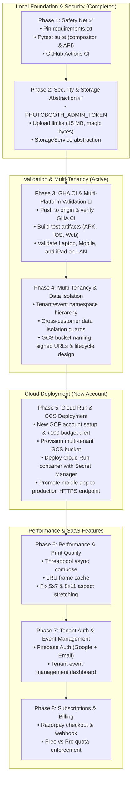

# Photo Booth — Comprehensive Roadmap & Next Steps

This document outlines the current operational status, strategic infrastructure decisions (Cloud Run vs. Local, Free Tier analysis), and a concrete, security-hardened implementation plan to take the Photo Booth from local prototype to commercial SaaS.

---

## 1. Current State & Verification (October 2026)

* **Stack & Health**: Docker Compose stack (`backend` on `:3201`, `web` on `:3200`) is active and passing health checks (`cm test photo-booth` 2/2).
* **Restored Production Data**: 83 MB across 135 files (sessions `PhotoBooth_27092026` and `PhotoBooth_03102026`) safely restored from Mac backup.
* **Core Flow**: Webcam capture $\rightarrow$ frame selection $\rightarrow$ canvas composition $\rightarrow$ preview $\rightarrow$ final download works end-to-end.
* **Critical Findings Before Cloud Deployment**:
  1. **Destructive Endpoints Unprotected**: `POST /admin/cleanup` (which can wipe all finals/previews) and `POST /frames/upload` have no authentication. Deploying to Cloud Run with `--allow-unauthenticated` in this state would expose them to the public internet.
  2. **Upload Constraints**: Lack of file size and magic-byte checks exposes a 512 MiB Cloud Run instance to memory exhaustion (OOM).
  3. **Ephemeral Storage**: Cloud Run instances have ephemeral filesystems. Images written to `/app/data` vanish when instances scale down to 0 unless backed by Google Cloud Storage (GCS).
  4. **LAN Testing Limitation**: `scripts/start-https-proxy.sh` uses macOS-specific `ipconfig getifaddr en0`, which breaks on Windows/WSL2.

---

## 2. Infrastructure Strategy: Cloud Run Timing & Free Tier

### 2.1 Should We Switch to Cloud Run Now or at the End?

**Decision: Fast-track Cloud Run to Phase 3 (Early Deployment), but NEVER before Phase 2 (Security & Storage Abstraction).**

| Strategy | Pros | Cons | Recommendation |
|---|---|---|---|
| **Deploy Immediately (Day 1)** | • Immediate global HTTPS URL<br>• Camera `getUserMedia` works on mobile without self-signed certs<br>• Easy testing from 4G/5G anywhere | • **Data Loss**: Photos vanish when container scales to 0<br>• **Security Vulnerability**: Anyone can trigger `/admin/cleanup`<br>• **Crash Risk**: Large 12 MP photos can OOM a 512 MB instance | ❌ **Dangerous** |
| **Wait Until Very End (After Billing & Auth)** | • Everything built before going live | • Delays real-world mobile testing on physical devices<br>• Painful local Wi-Fi / self-signed certificate workarounds | ❌ **Too Slow** |
| **Phased Early Switch (Phase 3 - Recommended)** | • Lock down security & storage first (2 days)<br>• Deploy Cloud Run + GCS as the permanent mobile backend<br>• Test physical phone apps anywhere with zero cert issues | • Requires 1-2 days of groundwork before cloud deploy | ✅ **Recommended Sweet Spot** |

### 2.2 Google Cloud Free Tier Reality for Initial Productization

Google Cloud's **Always Free Tier** is more than sufficient for development, prototype demos, and early beta testing with zero out-of-pocket costs:

1. **Google Cloud Run**:
   * **Free Tier**: 2,000,000 requests/month, 360,000 GB-seconds of memory, 180,000 vCPU-seconds.
   * **Behavior**: Scales to **0 instances** when idle. If you aren't actively testing, it consumes **0 compute and ₹0**.
   * **Instance Sizing**: 1 vCPU + 1 GiB memory comfortably stays in free tier for thousands of photo sessions.
2. **Google Cloud Storage (GCS)**:
   * **Free Tier**: 5 GB-months of standard storage (US regions) or ~$0.023/GB/mo in Mumbai (`asia-south1` — less than ₹2 per GB).
   * **Lifecycle Rules**: Automatically delete temporary previews after 24 hours to keep usage well under 1 GB.
3. **Firebase Authentication & Firestore**:
   * **Free Tier**: Unlimited email/password, 50,000 MAU, 1 GiB database storage, 50,000 document reads/day.
4. **Billing & Budget Safety Guard**:
   * A valid billing account (Credit/Debit card) is required to activate Cloud Run, but Google Cloud does **not** charge if usage remains within free limits.
   * **Crucial Rule**: Before launching any cloud resource, create a budget alert at **₹100 ($1)** with email notifications in the GCP Console (*Billing $\rightarrow$ Budgets & alerts*).

---

## 3. Phased Implementation Roadmap



---

### Phase 1: Safety Net (Tests, CI, Dependency Pinning) — ✅ COMPLETED (2026-10-04)
* **Goal**: Establish automated testing and reproducible builds so changes never break existing workflows.
* **Status**: **100% Complete & Verified** (Commit `8a2e226`).
  - Pinned exact production versions in `apps/api/requirements.txt` (`fastapi==0.142.2`, `uvicorn[standard]==0.54.0`, `pillow==12.3.0`, `python-multipart==0.0.32`).
  - Added dev dependencies in `apps/api/requirements-dev.txt` (`pytest==8.4.2`, `httpx==0.28.1`).
  - Created compositor unit test suite (`apps/api/tests/test_compositor.py`).
  - Created REST API integration test suite (`apps/api/tests/test_api.py`).
  - Added GitHub Actions API CI workflow (`.github/workflows/api-ci.yml`).
  - Test run: **79 passed, 8 xfailed** (tracking 5x7 and 8x11 aspect stretching to resolve in Phase 6).

---

### Phase 2: Security Hardening & Storage Abstraction — ✅ COMPLETED (2026-10-04)
* **Goal**: Close vulnerabilities that block cloud exposure and isolate filesystem concerns.
* **Status**: **100% Complete & Committed** (Commit `1fe567d`).
  - **Admin Token Authentication**: Protected `POST /admin/cleanup` and `POST /frames/upload` with `verify_admin_token` dependency (`Authorization: Bearer <PHOTOBOOTH_ADMIN_TOKEN>`). Secure-by-default: routes reject with `401 Unauthorized` if token is unset or invalid.
  - **Upload Constraints**: Enforced 15 MB payload limit on photos and 5 MB on frame templates (`413 Payload Too Large`).
  - **Magic Byte Validation**: Direct header inspection for JPEG (`\xff\xd8`), PNG (`\x89PNG`), WebP (`RIFF...WEBP`), returning `415 Unsupported Media Type` on mismatch. Strict PNG validation for frame templates.
  - **Decompression Bomb Guard**: Pillow `Image.MAX_IMAGE_PIXELS = 50_000_000`.
  - **Path Traversal Guards**: Strict regex allowlist on `frame_id` (`^[a-zA-Z0-9_-]{0,40}$`) and `size` against `PRINT_PRESETS`.
  - **Storage Abstraction Interface**: Created `apps/api/app/services/storage.py` introducing `StorageService` ABC and `LocalStorageService` to decouple route handlers from disk operations.
  - **Container Security**: Added non-root user `photobooth:photobooth` (UID 10001) to `apps/api/Dockerfile` and `Dockerfile.cloudrun`, plus added `.dockerignore`.
  - **Environment Parity**: Synced all modifications across Windows and WSL repositories.

---

### Phase 3: GHA Pipeline Verification & Multi-Platform Validation — 🚀 ACTIVE NEXT PHASE
* **Goal**: Verify GitHub Actions CI triggers properly on pushed commits, build downloadable artifacts, and validate the photo booth working across Laptop, Mobile (Android), and iPad before touching any cloud infrastructure.
* **Tasks**:
  1. **Push Commits to Remote & Verify GHA**:
     - Push commits `8a2e226` and `1fe567d` to `origin/main`.
     - Confirm `.github/workflows/api-ci.yml` triggers automatically and passes all unit/integration tests and Docker image builds on GitHub's hosted runners.
  2. **GHA Mobile & Web Artifact Pipeline**:
     - Update `.github/workflows/mobile-build.yml` with default LAN endpoint (`http://192.168.1.2:3201`).
     - Trigger workflow to build and upload downloadable artifacts:
       * **Android Debug APK** (`photo-booth-app-apk`): Installable `.apk` for physical Android phones on Wi-Fi.
       * **Web Bundle Artifact** (`photo-booth-web-bundle`): Configured static distribution for desktop/tablet browser testing.
       * **iOS Simulator `.app`**: Validated artifact for iPad/iOS testing.
  3. **Multi-Platform Device Validation Checklist**:
     - **Laptop (Windows / Mac)**:
       * Access `http://localhost:3200` (already verified working with active webcam and controls!).
       * Test camera capture $\rightarrow$ frame selection $\rightarrow$ preview $\rightarrow$ download final.
     - **Mobile Phone (Android)**:
       * Install debug APK on phone connected to local Wi-Fi.
       * Verify camera permission dialog, front/rear camera toggle, 10s pose countdown, frame overlay preview, and image saving to gallery.
     * Alternatively, test via Chrome mobile at `http://192.168.1.2:3200`.
     - **iPad / Tablet (iOS / iPadOS)**:
       * Test web bundle or mobile app on iPad.
       * Address iOS Safari secure-context requirement for `getUserMedia` (Capacitor native app operates in local secure context `https://localhost`, or use LAN proxy).
       * Verify touch controls, landscape/portrait orientation switches, and canvas rendering.
* **Verification**: All 3 devices (laptop, mobile phone, iPad) can capture, frame, and preview photos against the local backend.

---

### Phase 4: Multi-Tenancy & Data Isolation Architecture (Design & Storage Prep)
* **Goal**: Establish strict tenant and event isolation so no 2 customers can ever view, query, or access each other's photos or sessions, before provisioning any cloud storage.
* **Tasks**:
  1. **Tenant & Event Data Partitioning**:
     - Design storage namespace hierarchy:
       ```
       tenants/{tenant_id}/events/{event_id}/sessions/{session_id}/
         ├── originals/   # Raw camera snapshots
         ├── previews/    # Downscaled display compositions (24h retention)
         └── finals/      # 300 DPI high-res print outputs
       ```
     - Inject `tenant_id` context into all API operations via header (`X-Tenant-ID`) or authenticated claims.
     - Enforce tenant boundaries in `StorageService`: reading or listing files must strictly check that requested paths belong to the caller's tenant.
  2. **GCS Bucket Architecture & Access Restrictions**:
     - Standardized bucket naming: `gs://<project-prefix>-photobooth-data`.
     - Private-by-default bucket policy (block all public read access).
     - Fine-grained Signed URLs: Backend generates short-lived (15-minute) signed download URLs for previews and finals so GCS objects are never public.
     - Automated lifecycle policy: GCS lifecycle rule automatically deletes `*/previews/*` after 24 hours, preventing storage accumulation in the free tier.
* **Verification**: Architectural specification and test cases proving customer A cannot read or list customer B's session data.

---

### Phase 5: Google Cloud Setup (New Account) & Cloud Run / GCS Deployment
* **Goal**: Provision the production cloud backend under a clean, dedicated Google Cloud account and deploy the container.
* **Tasks**:
  1. **New GCP Account Setup**:
     - Create a dedicated Google Cloud account / project (separate email) to avoid mixing personal resources.
     - Set a strict **₹100 ($1)** monthly budget alert in Billing to guarantee zero accidental spend.
     - Enable Cloud Run, Cloud Build, and Cloud Storage APIs.
  2. **GCS Provisioning**:
     - Create bucket in `asia-south1` (Mumbai) or free-tier region following Phase 4 naming conventions.
     - Apply 24h lifecycle deletion rule on previews.
     - Implement `GCSStorageService` in `apps/api/app/services/storage.py` using signed URLs when `PHOTOBOOTH_STORAGE=gcs`.
  3. **Cloud Run Deployment**:
     - Store `PHOTOBOOTH_ADMIN_TOKEN` securely in Google Secret Manager.
     - Deploy using `scripts/deploy-cloudrun.sh` with 1 vCPU, 1 GiB memory, concurrency 4, min-instances 0, max-instances 2.
     - Obtain global HTTPS URL: `https://photo-booth-api-<hash>.a.run.app`.
  4. **Promote Mobile & Web Packages**:
     - Update mobile build endpoint to Cloud Run HTTPS URL and verify camera and sync work over cellular (4G/5G).
* **Verification**: Photos captured on mobile over 4G persist into GCS bucket partitioned by tenant.

---

### Phase 6: Performance & Print Quality
* **Goal**: Accelerate processing and resolve print aspect distortion.
* **Tasks**:
  1. **Non-Blocking Compositor**: Move `compose_image` to threadpool via FastAPI `run_in_threadpool`.
  2. **LRU Frame Cache**: In-memory cache for decoded RGBA frames dropping latency to < 200 ms.
  3. **Lightweight Previews**: Downscale preview generation to 900 px max edge at quality 85.
  4. **Aspect Ratio Correction**: Correct 5x7 and 8x11 frames with proper scaling/letterboxing.
  5. **Indian Timezone Alignment**: Default `PHOTOBOOTH_TZ=Asia/Kolkata`.
* **Verification**: Benchmark test showing compose response under 300 ms for warm frames.

---

### Phase 7: Tenant Authentication & Event Management UI
* **Goal**: Provide a web portal for event managers and photographers.
* **Tasks**:
  1. Integrate Firebase Authentication (Google Sign-In + Email/Password).
  2. Validate Firebase JWT tokens in FastAPI backend.
  3. Tenant event dashboard: create events, select frame templates, configure print sizes.
* **Verification**: Photographers log in, configure an event, and view only their event gallery.

---

### Phase 8: Commercial Subscriptions & Billing (Razorpay)
* **Goal**: Monetize the platform for the Indian event market.
* **Tasks**:
  1. Razorpay checkout modal for Single Event (₹999) and Monthly Pro (₹1,499).
  2. Webhook endpoint `/api/billing/webhook/razorpay` with HMAC signature verification.
  3. Automatic tier activation upon payment success.
* **Verification**: Test mode checkout upgrades tenant account to Pro tier.

---

## 4. Quick Command Reference

```bash
# === Local Stack & Testing ===
cm up photo-booth                               # Start local stack
cm test photo-booth                             # Validate local health endpoints
docker compose logs -f backend                  # Follow backend API logs

# === Test Suite ===
pytest apps/api/tests/                          # Run unit & integration tests

# === GitHub Actions & Artifacts ===
git push origin main                            # Trigger GHA API CI workflow
gh workflow run "Mobile Build (APK + IPA)"      # Trigger mobile/web artifact build

# === Cloud Deployment (Phase 5) ===
gcloud auth login                               # Login with new dedicated Google account
gcloud config set project <new-project-id>      # Select GCP project
CLOUDRUN_REGION=asia-south1 ./scripts/deploy-cloudrun.sh
```
